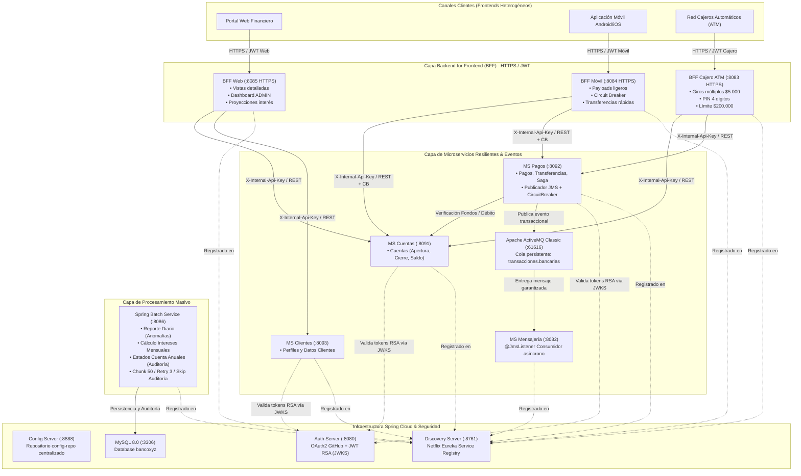
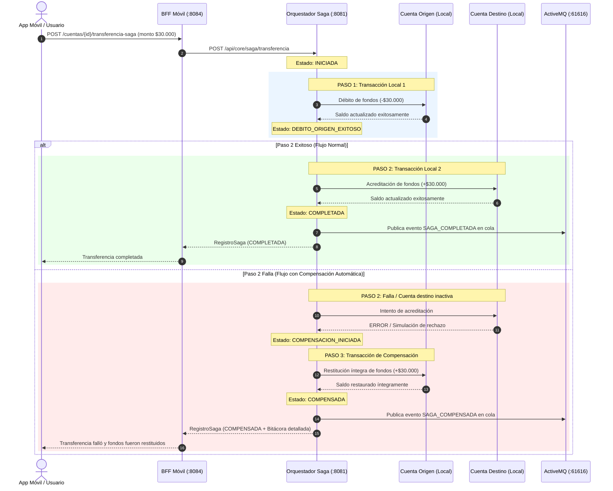

# INFORME TÉCNICO Y PROPUESTA DE ARQUITECTURA DISTRIBUIDA
## Evaluación Final Transversal: Desarrollo Backend Avanzado (Spring Cloud, Spring Batch y Patrón BFF)
### Caso Práctico: Modernización de la Plataforma Bancaria Legacy del Banco XYZ

---

* **Asignatura:** Desarrollo Backend III 
* **Estudiantes:** Leonardo Bustamante
* **Fecha:** Octubre 2026  
* **Repositorio de Código:** [README.md](file:///C:/Users/kk638/Desktop/Exp3_S8_Grupo3-main/README.md)

---

## 1. Resumen Ejecutivo del Proyecto

El **Banco XYZ** es una institución bancaria de primer orden con más de 30 años de trayectoria financiera en el mercado nacional. Su infraestructura histórica de procesamiento transaccional operaba sobre sistemas mainframe monolíticos basados en **COBOL** y scripts **Shell/JCL**, los cuales presentaban graves problemas de escalabilidad vertical, altos costos de licenciamiento y hardware propietario, rigidez para la integración de canales digitales modernos e indisponibilidad operativa durante las ventanas nocturnas de procesamiento batch masivo.

Para resolver estas limitaciones operativas, el Banco XYZ ha implementado una arquitectura de microservicios distribuida, moderna, segura, resiliente y preparada para despliegue en entornos Cloud (AWS). La solución desarrollada en este proyecto abarca tres áreas tecnológicas fundamentales:

1. **Migración de Procesos Batch Masivos con Spring Batch (`batch-service`):**  
   Reescritura completa de los tres procesos batch históricos del mainframe basados en el dataset legacy:
   - **Reporte de Transacciones Diarias:** Ingesta de transacciones operativas, depuración/rectificación de anomalías (montos negativos o malformados) y persistencia en tabla `transacciones_procesadas`.
   - **Cálculo de Intereses Mensuales:** Cálculo automatizado y devengo de interés mensual (5% anual / 12 meses) para cuentas corrientes y de ahorro con persistencia en `intereses_procesados`.
   - **Generación de Estados de Cuenta Anuales para Auditoría:** Consolidación de movimientos anuales y persistencia en `cuentas_anuales_procesadas`.
   - **Optimización y Tolerancia a Fallos:** Procesamiento basado en *Chunks* multihilo con `TaskExecutor`, políticas de reintento (`retryLimit = 3`) ante caídas de conexión, políticas de omisión de errores tolerables (`skipLimit = 100`) y bitácora de auditoría de descartes persistida en tabla `batch_registros_rechazados` en base de datos MySQL.

2. **Implementación de Capas Backend for Frontend (BFF) por Canal:**  
   Eliminación del cuello de botella generado por el monolito único al desacoplar las necesidades de los tres canales clientes:
   - **BFF Web (`bff-web` - Puerto 8085 HTTPS):** Diseñado para aplicaciones de navegador y ejecutivos de cuenta, provee payloads enriquecidos, saldos con líneas de sobregiro, proyecciones de intereses anuales, desglose histórico de movimientos anuales y dashboard gerencial consolidado con control de acceso basado en roles (RBAC - `ROLE_ADMIN`).
   - **BFF Móvil (`bff-movil` - Puerto 8084 HTTPS):** Optimizado para smartphones con ancho de banda y latencia restringidos, provee payloads mínimos ultraligeros (últimas 3 transacciones, saldo express, transferencias ágiles), autorización por cuenta y **alta resiliencia con Resilience4j (Circuit Breaker y Retry)** en modo degradado ante indisponibilidad del backend.
   - **BFF Cajeros Automáticos ATM (`bff-cajero` - Puerto 8083 HTTPS):** Interfaz segura para terminales de autoservicio físico, especializada en consultas rápidas de saldo remanente y dispensación de efectivo en múltiplos exactos de $5.000, validación de PIN de seguridad de 4 dígitos, tope máximo de giro por transacción ($200.000) y generación de códigos únicos de autorización bancaria.
   - **Seguridad Perimetral de Canales:** Autenticación y autorización diferenciada mediante tokens JWT específicos por canal (`WEB`, `MOVIL`, `CAJERO_ATM`), cifrado en tránsito HTTPS con certificados digitales PKCS12 (`keystore.p12`) y comunicación inter-servicios blindada con cabecera de autenticación mutua `X-Internal-Api-Key`.

3. **Arquitectura de Microservicios Resilientes con Spring Cloud:**  
   El antiguo backend monolítico (`core-service`) fue formalmente descompuesto en microservicios independientes y especializados:
   - **Gestión de Cuentas (`ms-cuentas` - Puerto 8091):** Maneja ciclo de vida completo de cuentas (apertura, mantención, consulta de saldo contable y sobregiro, cierre).
   - **Procesamiento de Pagos (`ms-pagos` - Puerto 8092):** Procesa pagos, transferencias, retiros y depósitos, interactuando con cuentas y publicando eventos a Apache ActiveMQ.
   - **Gestión de Clientes (`ms-clientes` - Puerto 8093):** Administra información personal, perfiles y reglas etarias de los cuentahabientes.
   - **Configuración Centralizada (`config-server` - Puerto 8888):** Spring Cloud Config Server que distribuye de forma centralizada los parámetros operacionales y de seguridad a todos los microservicios y BFFs desde el repositorio `config-repo`.
   - **Detección Dinámica de Servicios (`discovery-server` - Puerto 8761):** Netflix Eureka Server con autenticación HTTP Basic (`eureka:eureka2026`), permitiendo el registro automático, balanceo de carga y descubrimiento dinámico de todos los nodos.
   - **Seguridad OAuth 2.0 y Emisor JWT Asimétrico (`auth-server` - Puerto 8080):** Servidor de autorización que delega el inicio de sesión federado en GitHub OAuth 2.0 y genera tokens JWT firmados asimétricamente con clave privada RSA de 2048 bits (algoritmo RS256), exponiendo la clave pública mediante el estándar RFC 7517 en el endpoint JWKS (`/.well-known/jwks.json`).
   - **Mensajería Asíncrona Orientada a Eventos:** Integración con broker **Apache ActiveMQ Classic** a través de colas JMS persistentes (`transacciones.bancarias`) y desacoplamiento con el consumidor `ms-mensajeria` (Puerto 8082).
   - **Base de Datos Relacional:** Servidor **MySQL 8.0** (`bancoxyz`) para persistencia relacional transaccional y tablas de auditoría batch.
   - **Desacoplamiento Maven Total:** Cada microservicio es un proyecto Maven 100% independiente con su propio `pom.xml`, sin acoplamiento forzado a un POM padre único. Todos los servicios cuentan con `Dockerfile` y están orquestados de manera integral mediante `docker-compose.yml` en la red privada `banco-net`.

4. **Patrón Saga Orquestado para Transacciones Distribuidas:**  
   Implementación del patrón **Saga con Orquestador Centralizado y Compensación Automática** para garantizar consistencia transaccional eventual sin incurrir en los cuellos de botella del Two-Phase Commit (2PC):
   - **Orquestación en 2 Pasos:** Ejecución secuencial de débitos locales en la cuenta de origen y abonos en la cuenta de destino.
   - **Transacción de Compensación Automática:** Restitución inmediata y garantizada del 100% de los fondos a la cuenta de origen ante fallos en la cuenta de destino o timeout interbancario.
   - **Trazabilidad y Bitácora Auditada:** Ciclo de vida con estados (`INICIADA`, `DEBITO_ORIGEN_EXITOSO`, `COMPLETADA`, `COMPENSADA`), bitácora cronometrada y emisión de eventos asíncronos a ActiveMQ.
   - **Simulación Pedagógica:** Flag `simularFalloDestino: true` para verificación visual de contingencias.

---

## 2. Diagrama de Arquitectura Global de la Solución

---

## 3. Desglose Técnico por Secciones de la Evaluación

### 3.1. Parte 1: Migración de Procesos Batch con Spring Batch

El microservicio `batch-service` (puerto 8086) reemplaza los antiguos programas COBOL nocturnos y scripts Shell/JCL. Utiliza Spring Boot 3.2.5 con Spring Batch y base de datos relacional MySQL 8.0 (`bancoxyz`) tanto para el repositorio de metadatos (`JobRepository`) como para las tablas de salida y auditoría.

#### Procesos Batch Implementados

1. **Job 1: Reporte de Transacciones Diarias (`reporteTransaccionesDiariasJob`)**
   - **Fuente de Datos:** `movimientos_financieros_diarios.csv` (ingesta estructurada con `FlatFileItemReader`).
   - **Processor (`TransaccionesDiariasProcessor`):** Inspecciona transacciones bancarias, detecta y rectifica anomalías en montos (valores negativos o corruptos generados en terminales legacy), normaliza tipos de operación y calcula totales y saldos operativos.
   - **Writer (`ReporteDiarioWriter`):** Escribe chunks de 50 registros, generando métricas de auditoría sobre transacciones limpias vs anómalas y montos consolidados.
   - **Tolerancia a Fallos:** Reintentos ante errores de conexión (`retryLimit = 3`) y omisión de líneas con parseo inválido (`skipLimit = 100`, con `RegistroSkipListener`).

2. **Job 2: Cálculo de Intereses Mensuales (`calculoInteresesMensualesJob`)**
   - **Fuente de Datos:** `intereses_trimestrales.csv`.
   - **Processor (`CalculoInteresesProcessor`):** Evalúa saldos contables, tipos de cuenta (Ahorro, Corriente) y edad del titular. Aplica las tasas de devengo correspondientes y liquida el interés proyectado o abonado por cuenta.
   - **Writer (`CalculoInteresesWriter`):** Persiste y totaliza los intereses devengados/acreditados por chunk consolidado.

3. **Job 3: Generación de Estados de Cuenta Anuales para Auditoría (`estadosCuentaAnualesJob`)**
   - **Fuente de Datos:** `estados_financieros_anuales.csv`.
   - **Processor (`EstadosCuentaAnualesProcessor`):** Reconcilia saldos acumulados anuales, total de créditos y total de débitos por cliente y cuenta bancaria, estructurando el resumen para auditoría externa y entes fiscalizadores.
   - **Writer (`EstadosCuentaWriter`):** Genera bitácora de auditoría chunk a chunk registrando volúmenes financieros certificados.

#### Configuración de Resiliencia, Concurrencia y Políticas de Fallo
- **Procesamiento en Chunks:** Se configuró un tamaño de chunk de 50 registros administrado mediante `PlatformTransactionManager`, garantizando atomicidad y rollback granular ante fallos.
- **Concurrencia (`BatchTaskExecutorConfig`):** Se implementó un `ThreadPoolTaskExecutor` (Pool Core: 4, Max: 8, Queue: 100) para procesamiento multi-hilo en entornos con altos volúmenes de datos.
- **Ejecución y Monitoreo REST (`BatchJobController`):** Se expusieron endpoints REST (`/api/v1/batch/ejecutar/...` y `/api/v1/batch/historial`) para lanzamiento bajo demanda o programación desde crontabs externos, retornando el estado de ejecución (`COMPLETED`, `FAILED`, `STARTED`).

---

### 3.2. Parte 2: Implementación del Patrón Backend for Frontend (BFF)

Para eliminar el cuello de botella que significaba exponer un backend único a consumidores radicalmente distintos, se implementaron tres BFFs satélites, independientes y autónomos:

| Característica | BFF Web (`bff-web`) | BFF Móvil (`bff-movil`) | BFF Cajero ATM (`bff-cajero`) |
| :--- | :--- | :--- | :--- |
| **Puerto y Protocolo** | `8085` HTTPS (TLS / PKCS12) | `8084` HTTPS (TLS / PKCS12) | `8083` HTTPS (TLS / PKCS12) |
| **Audiencia** | Portal Web clientes y ejecutivos | Aplicaciones móviles iOS / Android | Cajeros Automáticos terminales físicos |
| **Estrategia de Payloads** | Payload completo enriquecido con límites, tasas de interés proyectadas y movimientos anuales | Payload ultraligero y condensado (últimas 3 transacciones, saldo express) | Payload específico para transacciones en efectivo y códigos de autorización |
| **Reglas de Negocio Propias** | Dashboard consolidado con métricas de capital total y distribución por tipo de cuenta | Transferencia rápida con validación de límite de datos | Giros exclusivamente en múltiplos de $5.000, PIN 4 dígitos, tope $200.000 |
| **Mecanismo de Resiliencia** | Fallback HTTP controlado | **Resilience4j Circuit Breaker + Retry** con modo contingencia degradado | Validación estricta con códigos bancarios de autorización |
| **Autenticación y RBAC** | JWT con claim `canal: WEB`, soporte de rol `ADMIN` para dashboard | JWT con claim `canal: MOVIL`, autorización ligada a `cuentaId` | JWT con claim `canal: CAJERO_ATM` generado por autenticación de terminal |
| **Conexión a Core Bancario** | `CoreClient` con cabecera `X-Internal-Api-Key` | `CoreClient` con cabecera `X-Internal-Api-Key` | `CoreClient` con cabecera `X-Internal-Api-Key` |

#### Análisis de Acoplamiento y Cohesión de los BFFs
- **Acoplamiento Débil:** Los BFFs no comparten base de datos ni modelos de dominio con el core bancario. Consumen las APIs REST del Core mediante `RestClient` optimizado (`CoreClient.java`).
- **Seguridad Inter-Servicios:** `ms-cuentas`, `ms-pagos` y `ms-clientes` validan las peticiones internas mediante el filtro `ApiKeyFilter` verificando la cabecera `X-Internal-Api-Key: SecretCoreKeyBancoXYZ2026`, o bien tokens JWT OAuth2.
- **Tolerancia a Fallos en Canal Móvil:** Si `ms-cuentas` o `ms-pagos` experimentan latencia o caída, el Circuit Breaker de `bff-movil` salta a estado abierto y activa `fallbackObtenerResumenMovil`, devolviendo un estado en modo contingencia ("Servicio operando en modo degradado por contingencia del Core Bancario") sin colapsar la app móvil.

---

### 3.3. Parte 3: Microservicios Resilientes con Spring Cloud

#### A. Microservicios de Dominio Bancario (`ms-cuentas`, `ms-pagos`, `ms-clientes`)

El antiguo backend monolítico (`core-service`) fue formalmente reemplazado por tres microservicios independientes, cada uno con su propio `pom.xml`, `Dockerfile`, configuración en `config-repo` y registro autónomo en Eureka:

**MS Cuentas (`ms-cuentas` — Puerto 8091):**
Maneja el ciclo de vida completo de las cuentas bancarias:
- Apertura de cuentas (`POST /api/core/cuentas`), consulta detallada (`GET /api/core/cuentas/{id}`), listar todas (`GET /api/core/cuentas`), actualización de límites (`PUT /api/core/cuentas/{id}`) y cierre programado (`DELETE /api/core/cuentas/{id}`).
- Pool de Conexiones HikariCP calibrado con 10 conexiones máximas y 5 mínimas inactivas.

**MS Pagos (`ms-pagos` — Puerto 8092):**
Procesa las operaciones financieras transaccionales:
- Retiros bancarios (`POST /api/core/operaciones/retiro`), transferencias entre cuentas con Patrón Saga (`POST /api/core/operaciones/transferencia`) y depósitos (`POST /api/core/operaciones/deposito`).
- Publicación de eventos transaccionales asíncronos hacia Apache ActiveMQ.
- Circuit Breaker Resilience4j ante indisponibilidad del broker de mensajería.

**MS Clientes (`ms-clientes` — Puerto 8093):**
Administra la información de los cuentahabientes:
- Consulta de clientes (`GET /api/core/clientes`), perfil individual (`GET /api/core/clientes/{id}`) y actualización de perfil (`PUT /api/core/clientes/{id}`).

**Seguridad compartida:** Los tres microservicios validan peticiones internas mediante el filtro `ApiKeyFilter` (`X-Internal-Api-Key: SecretCoreKeyBancoXYZ2026`) y tokens JWT OAuth2 emitidos por `auth-server`.

#### B. Configuración Centralizada (`config-server`)
- Escucha en el puerto `8888` bajo autenticación básica (`admin:gato`).
- Almacena en `config-repo` los archivos de propiedades centralizados: `ms-cuentas.properties`, `ms-pagos.properties`, `ms-clientes.properties`, `auth_server.properties`, `ms-mensajeria.properties`, `bff-web.properties`, `bff-movil.properties`, `bff-cajero.properties` y `batch-service.properties`.
- Soporta perfiles nativos multi-ubicación (`file:./config-repo`, `file:./config-server/config-repo`), garantizando arranque transparente tanto en contenedores Docker como en entornos locales.

#### C. Detección Dinámica de Servicios (`discovery-server`)
- Netflix Eureka Server en puerto `8761`.
- Protegido por credenciales (`eureka:eureka2026`).
- Cada microservicio y BFF cuenta con `spring-cloud-starter-netflix-eureka-client` y `@EnableDiscoveryClient`, enviando heartbeats periódicos de salud al registro central.

#### D. Seguridad OAuth 2.0 y JWT Asimétrico (`auth-server`)
- Autenticación delegada en GitHub OAuth 2.0 mediante el flujo de concesión Authorization Code.
- Generación de claves asimétricas RSA de 2048 bits al inicio del servicio.
- Emisión de tokens de acceso JWT (RS256) firmados con la clave privada.
- Endpoint JWKS RFC 7517 expuesto en `GET /.well-known/jwks.json`, permitiendo a los Resource Servers verificar firmas criptográficas de manera autónoma sin llamadas síncronas de introspección.

#### E. Mensajería Asíncrona Orientada a Eventos (JMS + ActiveMQ)
- Broker **Apache ActiveMQ Classic** (`activemq:61616`).
- Cuando `ms-pagos` procesa exitosamente un retiro, depósito o transferencia, publica asíncronamente un `EventoTransaccion` en la cola persistente `transacciones.bancarias`.
- **Resilience4j en Mensajería:** Si ActiveMQ está fuera de línea, el Circuit Breaker de `ms-pagos` intercepta el fallo tras 3 intentos, aislando el error y almacenando el evento en una lista de contingencia local en memoria (`/api/core/mensajeria/contingencias`), permitiendo que la transacción contable del cliente termine con éxito.
- **Consumidor Dedicado (`ms-mensajeria`):** Escucha la cola mediante anotación `@JmsListener`, deserializa el payload JSON con `JacksonJmsMessageConverter` y registra la auditoría del movimiento financiero.

#### F. Desacoplamiento Maven Total y Autonomía de Microservicios
- Se eliminó cualquier dependencia jerárquica obligatoria de los microservicios hacia un POM raíz.
- Cada proyecto (`ms-cuentas`, `ms-pagos`, `ms-clientes`, `batch-service`, `bff-web`, `bff-movil`, `bff-cajero`, `auth-server`, `ms-mensajeria`, `config-server`, `discovery-server`) declara directamente su propio `<parent>` a `spring-boot-starter-parent` y gestiona sus dependencias de forma autónoma.
- Cada carpeta puede retirarse a cualquier máquina o repositorio independiente y compilar sin restricciones (`mvn clean package`).

#### G. Contenerización y Orquestación Docker Compose
El archivo `docker-compose.yml` orquesta los contenedores de la plataforma en la red privada puente `banco-net`:

| Servicio | Contenedor | Puerto Host:Container | Dependencias (`depends_on`) |
| :--- | :--- | :--- | :--- |
| **MySQL** | `mysql` | `3306:3306` | Ninguna |
| **ActiveMQ** | `activemq` | `61616:61616`, `8161:8161` | Ninguna |
| **Config Server** | `config-server` | `8888:8888` | Ninguna |
| **Discovery Server** | `discovery-server` | `8761:8761` | `config-server` |
| **Auth Server** | `auth-server` | `8080:8080` | `config-server`, `discovery-server` |
| **MS Cuentas** | `ms-cuentas` | `8091:8091` | `config-server`, `discovery-server`, `auth-server`, `mysql` |
| **MS Pagos** | `ms-pagos` | `8092:8092` | `config-server`, `discovery-server`, `auth-server`, `activemq`, `mysql` |
| **MS Clientes** | `ms-clientes` | `8093:8093` | `config-server`, `discovery-server`, `auth-server`, `mysql` |
| **MS Mensajería** | `ms-mensajeria` | `8082:8082` | `config-server`, `discovery-server`, `activemq` |
| **BFF Cajero ATM** | `bff-cajero` | `8083:8083` | `config-server`, `discovery-server`, `ms-cuentas`, `ms-pagos` |
| **BFF Móvil** | `bff-movil` | `8084:8084` | `config-server`, `discovery-server`, `ms-cuentas`, `ms-pagos` |
| **BFF Web** | `bff-web` | `8085:8085` | `config-server`, `discovery-server`, `ms-cuentas`, `ms-clientes` |
| **Batch Service** | `batch-service` | `8086:8086` | `config-server`, `discovery-server`, `mysql` |

#### H. Implementación del Patrón Saga Orquestado (Consistencia Eventual y Compensación Automática)

En una plataforma bancaria distribuida basada en microservicios, el clásico protocolo **Two-Phase Commit (2PC)** resulta inviable debido al bloqueo síncrono prolongado de recursos en bases de datos heterogéneas, la degradación exponencial del rendimiento y el riesgo inminente de deadlocks distribuidos.

Para superar esta limitación sin comprometer la integridad financiera de las cuentas, se implementó el **Patrón Saga Orquestado**:
- **Consistencia Eventual:** La transacción global se divide en transacciones locales independientes ejecutadas secuencialmente.
- **Orquestador Centralizado (`OrquestadorSagaTransferencia`):** Administra el flujo del negocio bancario y toma decisiones en tiempo real sobre avanzar o ejecutar compensaciones.
- **Transacción de Compensación Automática:** En caso de producirse un error en cualquiera de los pasos intermedios (por ejemplo, cuenta de destino inactiva o fallo de red), el orquestador dispara inmediatamente la compensación, devolviendo los fondos debitados a la cuenta de origen para restaurar el estado anterior al 100%.

##### Componentes Técnicos Implementados:
1. **`EstadoSaga` (Enum):** Modela formalmente las transiciones de estado: `INICIADA`, `DEBITO_ORIGEN_EXITOSO`, `ABONO_DESTINO_EXITOSO`, `COMPLETADA`, `FALLIDA`, `COMPENSACION_INICIADA`, `COMPENSADA`.
2. **`RegistroSaga` (DTO/Auditoría):** Mantiene la trazabilidad y la bitácora con marcas de tiempo precisas para cada paso ejecutado (`bitacoraPasos`).
3. **`SolicitudSagaTransferencia`:** Permite indicar cuentas, montos y el parámetro opcional `simularFalloDestino` para validaciones de compensación en defensas técnicas.
4. **`SagaController`:** Expone endpoints REST en `/api/core/saga/transferencia`, `/api/core/saga/historial` y `/api/core/saga/{sagaId}`.
5. **Integración con `bff-movil`:** Endpoint `POST /api/v1/movil/cuentas/{cuentaId}/transferencia-saga` protegido con JWT y tolerante a fallos mediante el Circuit Breaker de Resilience4j.

---

## 4. Comparación con el Sistema Legacy Mainframe COBOL

| Dimensión Operativa | Sistema Legacy (Mainframe COBOL / Shell) | Nueva Arquitectura Distribuida (Spring Cloud / Batch / BFF) |
| :--- | :--- | :--- |
| **Escalabilidad** | Escalabilidad vertical estricta; ampliación requería adquirir costosos MIPS de procesamiento en hardware mainframe propietario. | Escalabilidad horizontal elástica e independiente por microservicio; cada componente (BFF, Core, Batch) puede replicarse en contenedores según demanda. |
| **Disponibilidad** | Caídas o sobrecargas en un proceso paralizaban el sistema entero. Ventanas nocturnas exigían apagar terminales para correr lotes. | Alta disponibilidad garantizada (24/7). Los procesos batch corren concurrentemente sin degradar la atención online de los canales. |
| **Tolerancia a Fallos** | Bloqueo o cancelación completa del batch (*Abend*) ante cualquier error en un archivo CSV o caída de almacenamiento. | Tolerancia granular con **Resilience4j** (Circuit Breakers en Core y BFF Móvil) y políticas `skip/retry` en Spring Batch que aíslan registros erróneos. |
| **Experiencia de Usuario (UX)** | Un solo backend exponía estructuras de datos idénticas y rígidas. Las aplicaciones móviles sufrían por sobrecarga de datos. | **Patrón BFF:** Cada canal (Web, Móvil, Cajero) recibe payloads optimizados, reduciendo latencia móvil y asegurando giros ATM en múltiplos de $5.000. |
| **Seguridad** | Claves planas compartidas y seguridad perimetral anticuada. | Cifrado HTTPS en BFFs, autenticación OAuth 2.0 federada, tokens asimétricos RSA (RS256), autorización por canal y cabeceras internas seguras. |
| **Mantenibilidad y Despliegue** | Ciclos de cambio lentos (meses), alto riesgo de regresiones y dependencia de especialistas en lenguaje COBOL. | Despliegue continuo con Docker y Maven independiente. Equipos Frontend y Backend evolucionan de forma autónoma. |

---

## 5. Desafíos Enfrentados y Soluciones Implementadas

1. **Desafío: Inconsistencia y Malformaciones en Datos Legacy (CSV)**
   - *Problema:* Los datos provistos por el sistema mainframe contenían registros con transacciones en valores negativos, campos nulos y tipos de cuenta con sintaxis dispar.
   - *Solución:* Se programaron procesadores específicos en Spring Batch (`TransaccionesDiariasProcessor`) que aplican lógica de saneamiento de datos en memoria, rectificando anomalías monetarias, clasificando categorías de gasto/ingreso y configurando un `RegistroSkipListener` para registrar en auditoría cualquier línea con errores de parseo sin abortar el job.

2. **Desafío: Dependencia Rígida del Modelo Multimódulo en Maven**
   - *Problema:* El diseño inicial utilizaba un POM padre que obligaba a empaquetar y versionar todos los servicios de forma acoplada, impidiendo que los equipos de Frontend y Backend desplegaran de forma autónoma.
   - *Solución:* Se desacopló la jerarquía de herencia. Cada microservicio cuenta ahora con su propio POM independiente que hereda directamente de `spring-boot-starter-parent`. El archivo raíz `pom.xml` se redefinió como un agregador opcional para orquestación de compilaciones generales.

3. **Desafío: Colisiones de Puertos al Integrar los Proyectos de BFF**
   - *Problema:* Los BFFs provenían de un proyecto en paralelo donde usaban puertos locales que colisionaban con los microservicios de dominio (`ms-cuentas`: 8091, `ms-pagos`: 8092, `ms-clientes`: 8093) y `ms-mensajeria` (8082).
   - *Solución:* Se estableció una matriz ordenada y sin colisiones: Cajero (`8083`), Móvil (`8084`), Web (`8085`), y Batch (`8086`), estandarizando variables de entorno tanto para ejecución local como contenerizada.

4. **Desafío: Resiliencia de Mensajería ante Indisponibilidad de Red**
   - *Problema:* Si el broker ActiveMQ se saturaba o desconectaba, las operaciones transaccionales del cliente final corrían riesgo de fallar con error HTTP 500.
   - *Solución:* Se integró un Circuit Breaker con Resilience4j en `PublicadorTransacciones`. Tras fallar la publicación por 3 intentos, el circuito se abre y desvía la transacción hacia una lista de contingencia local, garantizando que el usuario obtenga una respuesta contable exitosa y protegiendo el negocio financiero.
