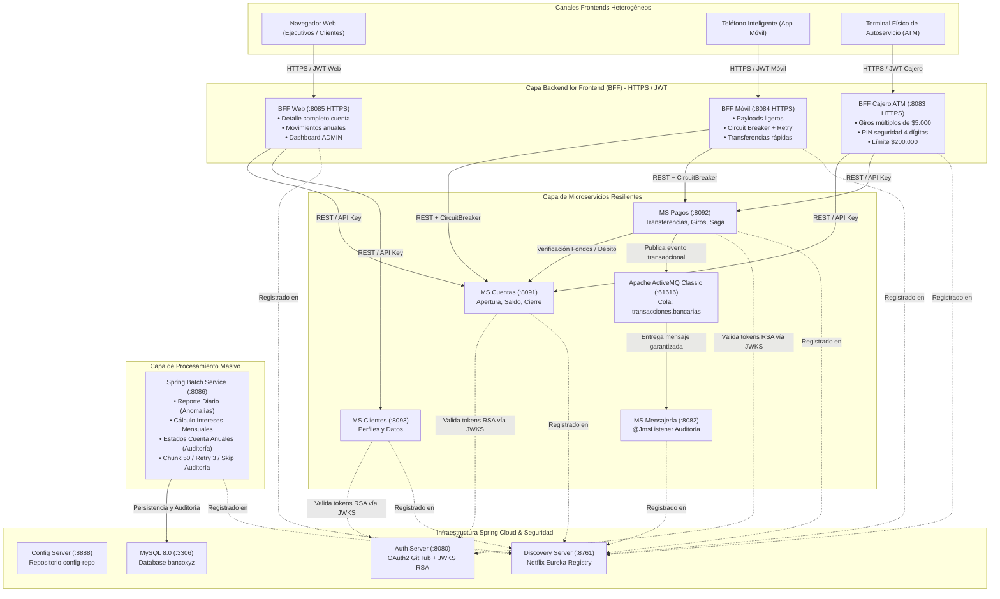
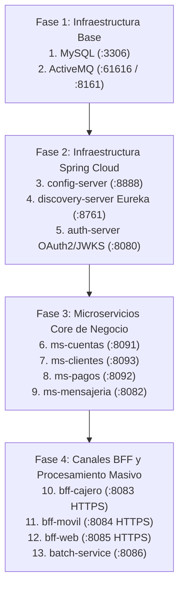

# Banco XYZ — Plataforma Backend Avanzada (Spring Cloud, Spring Batch y Patrón BFF)
## Evaluación Final Transversal: Modernización de Arquitectura Bancaria Legacy a Microservicios Cloud

---

* **Asignatura:** Desarrollo Backend III
* **Estudiantes:** Leonardo Bustamante   
* **Fecha:** Octubre 2026  
* **Informe Técnico Detallado:** [PROPUESTA_TECNICA.md](file:///C:/Users/kk638/Desktop/Exp3_S8_Grupo3-main/PROPUESTA_TECNICA.md)

---

## 1. Resumen Ejecutivo del Proyecto

El **Banco XYZ** contaba con una plataforma legacy sustentada en sistemas mainframe centralizados basados en **COBOL** y secuencias de scripts **Shell/JCL**. Dicho modelo presentaba severas restricciones de escalabilidad vertical, altos costos de soporte técnico y de licencias, rigidez para la interconexión con aplicaciones móviles y web modernas, y vulnerabilidad ante fallos en procesos masivos.

Para superar estos desafíos operacionales, se ha diseñado e implementado una arquitectura moderna orientada a microservicios distribuidos, resilientes, seguros y preparados para despliegue en la nube (AWS), abarcando:

1. **Migración de Procesos Batch con Spring Batch (`batch-service` - :8086):**  
   Reescritura de los tres procesos clave del banco basados en el repositorio [`fin_legacy_data`](https://github.com/KariVillagran/fin_legacy_data):
   - **Reporte de Transacciones Diarias:** Ingesta y detección/rectificación automática de anomalías contables, persistiendo en tabla `transacciones_procesadas`.
   - **Cálculo de Intereses Mensuales:** Devengo y cálculo de interés mensual (5% anual / 12 meses) sobre cuentas de ahorro y préstamos, persistiendo en tabla `intereses_procesados`.
   - **Generación de Estados de Cuenta Anuales:** Consolidación de saldos y transacciones para auditorías, persistiendo en tabla `cuentas_anuales_procesadas`.
   - **Resiliencia Batch:** Procesamiento por Chunks multihilo con `TaskExecutor`, reintentos (`retryLimit = 3`) ante fallos de conexión, políticas de omisión (`skipLimit = 100`) ante inconsistencias de parseo y auditoría de descartes en tabla `batch_registros_rechazados`.

2. **Implementación del Patrón Backend for Frontend (BFF):**  
   Tres microservicios especializados para optimizar la experiencia de usuario y aislar requerimientos por canal:
   - **BFF Web (`bff-web` - :8085 HTTPS):** Vistas complejas con saldos totales, sobregiros, intereses proyectados, historial y dashboard gerencial consolidado (`ROLE_ADMIN`).
   - **BFF Móvil (`bff-movil` - :8084 HTTPS):** Respuestas ultraligeras (últimas 3 transacciones, saldo rápido, transferencias ágiles) con **Resilience4j Circuit Breaker y Retry** en modo contingencia degradada ante caídas de los servicios de negocio.
   - **BFF Cajeros Automáticos ATM (`bff-cajero` - :8083 HTTPS):** Operaciones críticas de consulta y giros en múltiplos de $5.000, validación de PIN de 4 dígitos, límite de $200.000 y emisión de códigos de autorización.
   - **Seguridad Perimetral:** Tokens JWT por canal (`WEB`, `MOVIL`, `CAJERO_ATM`), certificados SSL/TLS con Keystore PKCS12 y comunicación inter-servicios blindada con cabecera `X-Internal-Api-Key`.

3. **Ecosistema de Microservicios Resilientes con Spring Cloud:**  
   El antiguo backend monolítico (`core-service`) ha sido completamente desacoplado y descompuesto en tres microservicios de dominio independientes:
   - **Gestión de Cuentas (`ms-cuentas` - :8091):** Apertura, cierre, saldos y mantenimiento de cuentas.
   - **Procesamiento de Pagos (`ms-pagos` - :8092):** Procesamiento de retiros, depósitos y transferencias con publicación de eventos transaccionales hacia Apache ActiveMQ.
   - **Gestión de Clientes (`ms-clientes` - :8093):** Administración de perfiles, información personal y reglas de edad/titularidad.
   - **Servidor de Configuración (`config-server` - :8888):** Centralización de parámetros operacionales en `config-repo`.
   - **Descubrimiento de Servicios (`discovery-server` - :8761):** Netflix Eureka Server con autenticación Basic (`eureka:eureka2026`).
   - **Servidor de Autorización (`auth-server` - :8080):** OAuth 2.0 federado con GitHub y emisor de tokens JWT asimétricos con claves RSA 2048-bit (RS256) vía JWKS RFC 7517.
   - **Mensajería Asíncrona JMS:** Broker **Apache ActiveMQ Classic** (`:61616`) y microservicio consumidor dedicado `ms-mensajeria` (`:8082`).
   - **Base de Datos Relacional:** Motor **MySQL 8.0** (`:3306`) para persistencia relacional y auditoría batch.
   - **Desacoplamiento Maven Total:** Cada microservicio es un proyecto Maven 100% autónomo y autocontenido (con su propio `pom.xml`), eliminando cualquier dependencia jerárquica a POMs padre.

4. **Patrón Saga Orquestado para Transacciones Distribuidas:**  
   Implementación del patrón **Saga con Orquestador y Compensación Automática** para garantizar consistencia eventual en transferencias bancarias:
   - **Flujo en 2 Pasos Locales:** Paso 1 (Débito en cuenta de origen) y Paso 2 (Acreditación en cuenta de destino).
   - **Compensación Inmediata:** Si el Paso 2 falla (cuenta no disponible, fondos bloqueados o timeout), el orquestador revierte de inmediato el débito devolviendo los fondos al origen.
   - **Trazabilidad y Bitácora:** Registro de estados (`INICIADA`, `DEBITO_ORIGEN_EXITOSO`, `COMPLETADA`, `COMPENSADA`) y flag `simularFalloDestino: true` para demostración pedagógica.

---

## 2. Mapa de Servicios y Puertos

| Módulo / Microservicio | Tipo / Función | Puerto Local / Docker | Protocolo / Seguridad |
| :--- | :--- | :--- | :--- |
| **`mysql`** | Base de Datos Relacional MySQL 8.0 | `3306` | TCP / Credenciales `admin:admin` |
| **`activemq`** | Broker Mensajería JMS (Colas persistentes) | `61616` (JMS) / `8161` (Web) | TCP OpenWire / Consola Web `admin:admin` |
| **`config-server`** | Servidor de Configuración Centralizada | `8888` | HTTP Basic (`admin:gato`) |
| **`discovery-server`** | Netflix Eureka Service Discovery | `8761` | HTTP Basic (`eureka:eureka2026`) |
| **`auth-server`** | Servidor Autorización OAuth2 + JWKS | `8080` | HTTP / OAuth2 GitHub + JWT RSA RS256 |
| **`ms-cuentas`** | Gestión de Cuentas Bancarias | `8091` | HTTP / Resource Server JWT + API Key |
| **`ms-pagos`** | Procesamiento de Pagos y Transacciones (Saga) | `8092` | HTTP / Resource Server JWT + JMS Producer |
| **`ms-clientes`** | Gestión de Clientes y Perfiles | `8093` | HTTP / Resource Server JWT + API Key |
| **`ms-mensajeria`** | Consumidor Asíncrono JMS (@JmsListener) | `8082` | HTTP / JMS Listener sobre ActiveMQ |
| **`bff-cajero`** | BFF Cajero Automático ATM | `8083` | **HTTPS** (Keystore PKCS12) + JWT Cajero |
| **`bff-movil`** | BFF Aplicación Bancaria Móvil (**Saga Client + Circuit Breaker**) | `8084` | **HTTPS** (Keystore PKCS12) + JWT Móvil + CB |
| **`bff-web`** | BFF Portal Web Financiero | `8085` | **HTTPS** (Keystore PKCS12) + JWT Web (RBAC) |
| **`batch-service`** | Procesos Batch (Transacciones, Intereses, Auditoría) | `8086` | HTTP / MySQL 8.0 + Spring Batch Metadata |

---

## 3. Diagrama de Arquitectura de la Solución



---

## 4. Estructura de Directorios del Proyecto

El repositorio está estructurado para garantizar la **independencia total** de cada microservicio:

```text
Exp3_S8_Grupo3-main/
├── pom.xml                             # POM Agregador para compilación global con un solo comando
├── docker-compose.yml                  # Orquestación de servicios en red banco-net
├── .env.example                        # Variables de entorno de despliegue
├── README.md                           # Documentación técnica integral
├── PROPUESTA_TECNICA.md                # Informe técnico de arquitectura, migración y AWS
│
├── config-server/                      # [Puerto 8888] Spring Cloud Config Server
│   ├── Dockerfile
│   ├── config-repo/                    # Repositorio de properties centralizados
│   │   ├── auth_server.properties
│   │   ├── ms-cuentas.properties
│   │   ├── ms-pagos.properties
│   │   ├── ms-clientes.properties
│   │   ├── ms-mensajeria.properties
│   │   ├── bff-web.properties
│   │   ├── bff-movil.properties
│   │   ├── bff-cajero.properties
│   │   └── batch-service.properties
│   └── src/main/java/.../ConfigServerApplication.java
│
├── discovery-server/                   # [Puerto 8761] Netflix Eureka Discovery Server
│   ├── Dockerfile
│   └── src/main/java/.../DiscoveryServerApplication.java
│
├── auth-server/                        # [Puerto 8080] Servidor OAuth 2.0 y JWKS RSA
│   ├── Dockerfile
│   └── src/main/java/.../AuthServerApplication.java
│
├── ms-cuentas/                         # [Puerto 8091] Microservicio Gestión de Cuentas
│   ├── Dockerfile
│   ├── pom.xml                         # Maven autónomo
│   └── src/main/java/.../
│
├── ms-pagos/                           # [Puerto 8092] Microservicio Procesamiento de Pagos y Saga
│   ├── Dockerfile
│   ├── pom.xml                         # Maven autónomo
│   └── src/main/java/.../
│
├── ms-clientes/                        # [Puerto 8093] Microservicio Gestión de Clientes
│   ├── Dockerfile
│   ├── pom.xml                         # Maven autónomo
│   └── src/main/java/.../
│
├── ms-mensajeria/                      # [Puerto 8082] Consumidor de Eventos JMS ActiveMQ
│   ├── Dockerfile
│   └── src/main/java/.../MsMensajeriaApplication.java
│
├── bff-cajero/                         # [Puerto 8083 HTTPS] BFF para Cajeros ATM
│   ├── Dockerfile
│   ├── src/main/resources/keystore.p12  # Certificado SSL digital PKCS12
│   └── src/main/java/.../BffCajeroApplication.java
│
├── bff-movil/                          # [Puerto 8084 HTTPS] BFF para Aplicaciones Móviles
│   ├── Dockerfile
│   ├── src/main/resources/keystore.p12  # Certificado SSL digital PKCS12
│   └── src/main/java/.../BffMovilApplication.java
│
├── bff-web/                            # [Puerto 8085 HTTPS] BFF para Portales Web
│   ├── Dockerfile
│   ├── src/main/resources/keystore.p12  # Certificado SSL digital PKCS12
│   └── src/main/java/.../BffWebApplication.java
│
└── batch-service/                      # [Puerto 8086] Procesamiento Batch con Spring Batch
    ├── Dockerfile
    ├── pom.xml                         # Maven autónomo
    ├── src/main/resources/schema.sql   # Tablas transacciones_procesadas, intereses, auditoría
    ├── src/main/resources/data/        # CSVs legacy (transacciones, intereses, anuales)
    └── src/main/java/.../BatchServiceApplication.java
```

---

## 5. Arquitectura Maven y Autonomía de Microservicios

Cada microservicio declara directamente su propio `<parent>` a `spring-boot-starter-parent` en su archivo `pom.xml` local. Son proyectos **100% autónomos y desacoplados**: no dependen jerárquicamente de un POM padre.
A nivel raíz, el archivo `pom.xml` actúa exclusivamente como **POM Agregador / Reactor**, lo que permite:
1. **Compilar y empaquetar toda la plataforma completa en un único comando** (`mvn clean package -DskipTests`).
2. **O bien gestionar, compilar y ejecutar cualquier microservicio de forma 100% individual y aislada**.

```bash
# Compilar y empaquetar un microservicio de forma 100% individual
cd ms-cuentas
mvn clean package -DskipTests

# Ejecutar el microservicio de forma aislada
mvn spring-boot:run
```

---

## 6. Guía de Ejecución y Despliegue de la Plataforma

Para levantar la solución completa existen **dos modalidades de ejecución**:

---

### 6.1. Opción 1: Despliegue en un Solo Comando (Docker Compose Orquestado)

Esta es la modalidad recomendada para iniciar toda la plataforma con sus 13 servicios (MySQL, ActiveMQ, Spring Cloud, Microservicios Core, BFFs y Spring Batch) de manera automatizada.

> [!IMPORTANT]
> **Precondición Indispensable:**  
> Los `Dockerfile` de cada microservicio empaquetan el binario `.jar` compilado (`COPY target/*.jar app.jar`). Por lo tanto, antes de ejecutar `docker compose up --build -d`, es obligatorio generar los archivos `.jar`. Con el POM agregador en la raíz, esto se realiza con un único comando:

```bash
# Paso 1: Compilar y empaquetar todos los microservicios en un solo comando (desde la raíz)
mvn clean package -DskipTests

# Paso 2: Iniciar y orquestar todos los contenedores en segundo plano
docker compose up --build -d

# Paso 3: Verificar el estado de salud de todos los contenedores
docker compose ps

# Paso 4: (Opcional) Inspeccionar logs consolidados o por servicio
docker compose logs -f
# o para un servicio específico: docker compose logs -f ms-cuentas

# Detener todos los contenedores cuando sea necesario
docker compose down
```

---

### 6.2. Opción 2: Despliegue Servicio por Servicio (1 a 1 en Orden de Dependencias)

Si se requiere iniciar los servicios de forma individual (ya sea ejecutándolos localmente con `mvn spring-boot:run` o levantando contenedores Docker uno a uno), **es fundamental respetar el orden estricto de dependencias arquitectónicas**:



#### Secuencia Detallada de Ejecución:

#### Fase 1: Infraestructura Base (Persistencia y Mensajería)
Los microservicios requieren que el motor de base de datos relacional y el broker JMS estén operativos antes de conectarse.
```bash
# Levantar únicamente MySQL y ActiveMQ con Docker:
docker compose up -d mysql activemq
```
*Verificación:* MySQL disponible en `localhost:3306` y consola ActiveMQ en `http://localhost:8161` (`admin:admin`).

#### Fase 2: Infraestructura Spring Cloud y Seguridad
Deben arrancarse en este orden exacto (esperando ~15 segundos entre cada uno para su completa estabilización):
1. **`config-server` (Puerto 8888):** Provee la configuración centralizada al resto de los microservicios.
   ```bash
   cd config-server
   mvn clean package -DskipTests
   mvn spring-boot:run
   # Alternativa Docker: docker compose up -d --build config-server
   ```
2. **`discovery-server` (Puerto 8761):** Eureka Service Registry. Permite el registro dinámico de componentes.
   ```bash
   cd ../discovery-server
   mvn clean package -DskipTests
   mvn spring-boot:run
   # Alternativa Docker: docker compose up -d --build discovery-server
   ```
3. **`auth-server` (Puerto 8080):** Servidor OAuth2 y proveedor de claves públicas JWKS RSA (`/.well-known/jwks.json`).
   ```bash
   cd ../auth-server
   mvn clean package -DskipTests
   mvn spring-boot:run
   # Alternativa Docker: docker compose up -d --build auth-server
   ```

#### Fase 3: Microservicios Core de Negocio y Consumo Asíncrono
Con la infraestructura base y de descubrimiento operativa, levantar los microservicios transaccionales:
1. **`ms-cuentas` (Puerto 8091):** Gestión de cuentas, saldos y movimientos.
   ```bash
   cd ../ms-cuentas
   mvn clean package -DskipTests
   mvn spring-boot:run
   # Alternativa Docker: docker compose up -d --build ms-cuentas
   ```
2. **`ms-clientes` (Puerto 8093):** Gestión de clientes, perfiles y datos personales.
   ```bash
   cd ../ms-clientes
   mvn clean package -DskipTests
   mvn spring-boot:run
   # Alternativa Docker: docker compose up -d --build ms-clientes
   ```
3. **`ms-pagos` (Puerto 8092):** Procesamiento de giros, transferencias, Saga y publicación a ActiveMQ.
   ```bash
   cd ../ms-pagos
   mvn clean package -DskipTests
   mvn spring-boot:run
   # Alternativa Docker: docker compose up -d --build ms-pagos
   ```
4. **`ms-mensajeria` (Puerto 8082):** Consumidor asíncrono `@JmsListener` sobre colas de ActiveMQ.
   ```bash
   cd ../ms-mensajeria
   mvn clean package -DskipTests
   mvn spring-boot:run
   # Alternativa Docker: docker compose up -d --build ms-mensajeria
   ```

#### Fase 4: Capa BFF (Backend for Frontend) y Procesamiento Batch
Finalmente, se levantan los BFF especializados por canal y el procesador masivo por lotes:
1. **`bff-cajero` (Puerto 8083 HTTPS):** Canal ATM (se comunica con `ms-cuentas` y `ms-pagos`).
   ```bash
   cd ../bff-cajero
   mvn clean package -DskipTests
   mvn spring-boot:run
   # Alternativa Docker: docker compose up -d --build bff-cajero
   ```
2. **`bff-movil` (Puerto 8084 HTTPS):** Canal Móvil con Circuit Breaker (se comunica con `ms-cuentas` y `ms-pagos`).
   ```bash
   cd ../bff-movil
   mvn clean package -DskipTests
   mvn spring-boot:run
   # Alternativa Docker: docker compose up -d --build bff-movil
   ```
3. **`bff-web` (Puerto 8085 HTTPS):** Portal Web gerencial y cliente (se comunica con `ms-cuentas` y `ms-clientes`).
   ```bash
   cd ../bff-web
   mvn clean package -DskipTests
   mvn spring-boot:run
   # Alternativa Docker: docker compose up -d --build bff-web
   ```
4. **`batch-service` (Puerto 8086):** Procesos Batch de reportes, cálculo de intereses y estados de cuenta (requiere MySQL).
   ```bash
   cd ../batch-service
   mvn clean package -DskipTests
   mvn spring-boot:run
   # Alternativa Docker: docker compose up -d --build batch-service
   ```

---

### 6.3. Verificación de Spring Batch (`batch-service` - :8086)

El microservicio expone endpoints REST para lanzar y auditar los jobs de procesamiento masivo legacy:

#### A. Ejecutar Job de Reporte de Transacciones Diarias (Detección de Anomalías)
```bash
curl -X POST http://localhost:8086/api/batch/jobs/transacciones-diarias
```
*Respuesta esperada:*
```json
{
  "jobName": "reporteTransaccionesDiariasJob",
  "status": "COMPLETED",
  "exitStatus": "COMPLETED",
  "readCount": 50,
  "writeCount": 50,
  "skipCount": 0
}
```

#### B. Ejecutar Job de Cálculo de Intereses Mensuales
```bash
curl -X POST http://localhost:8086/api/batch/jobs/calculo-intereses
```

#### C. Ejecutar Job de Estados de Cuenta Anuales para Auditoría
```bash
curl -X POST http://localhost:8086/api/batch/jobs/estados-cuenta-anuales
```

#### D. Ejecutar Pipeline Completo (Los 3 Jobs Consecutivos)
```bash
curl -X POST http://localhost:8086/api/batch/jobs/ejecutar-todos
```

#### E. Consultar Métricas y Resumen de Ejecuciones Batch
```bash
curl -X GET http://localhost:8086/api/batch/jobs/resumen
```

---

### 6.4. Verificación de los Canales BFF

Cada BFF corre sobre **HTTPS** con certificados digitales y maneja su propia seguridad por canal:

#### A. Canal Web (`bff-web` - :8085 HTTPS)
1. **Autenticación en Portal Web:**
   ```bash
   curl -k -X POST https://localhost:8085/api/v1/web/auth/login \
     -H "Content-Type: application/json" \
     -d '{"username":"ejecutivo_web","rol":"ADMIN"}'
   ```
2. **Consultar Detalle Completo de Cuenta (con movimientos anuales y proyección de interés):**
   ```bash
   curl -k -X GET https://localhost:8085/api/v1/web/cuentas/101 \
     -H "Authorization: Bearer <TOKEN_WEB>"
   ```
3. **Dashboard Consolidado (Requiere Rol ADMIN):**
   ```bash
   curl -k -X GET https://localhost:8085/api/v1/web/dashboard \
     -H "Authorization: Bearer <TOKEN_WEB>"
   ```

#### B. Canal Móvil (`bff-movil` - :8084 HTTPS)
1. **Autenticación en App Móvil:**
   ```bash
   curl -k -X POST https://localhost:8084/api/v1/movil/auth/login \
     -H "Content-Type: application/json" \
     -d '{"username":"cliente_movil","cuentaId":"101"}'
   ```
2. **Resumen Ultraligero (Últimas 3 transacciones, saldo express):**
   ```bash
   curl -k -X GET https://localhost:8084/api/v1/movil/cuentas/101 \
     -H "Authorization: Bearer <TOKEN_MOVIL>"
   ```
3. **Transferencia Rápida Móvil:**
   ```bash
   curl -k -X POST https://localhost:8084/api/v1/movil/cuentas/101/transferencia \
     -H "Authorization: Bearer <TOKEN_MOVIL>" \
     -H "Content-Type: application/json" \
     -d '{"cuentaDestinoId":102,"monto":15000,"comentario":"Pago almuerzo"}'
   ```

#### C. Canal Cajero Automático ATM (`bff-cajero` - :8083 HTTPS)
1. **Autenticar Terminal ATM:**
   ```bash
   curl -k -X POST https://localhost:8083/api/v1/cajero/auth/token \
     -H "Content-Type: application/json" \
     -d '{"terminalId":"ATM-SCL-01"}'
   ```
2. **Consulta Rápida de Saldo en Cajero:**
   ```bash
   curl -k -X GET "https://localhost:8083/api/v1/cajero/cuentas/101/saldo?terminalId=ATM-SCL-01" \
     -H "Authorization: Bearer <TOKEN_CAJERO>"
   ```
3. **Giro de Dinero en Efectivo (Múltiplos de $5.000 con PIN de 4 dígitos):**
   ```bash
   curl -k -X POST https://localhost:8083/api/v1/cajero/cuentas/101/retiro \
     -H "Authorization: Bearer <TOKEN_CAJERO>" \
     -H "Content-Type: application/json" \
     -d '{"monto":20000,"pin":"1234","terminalId":"ATM-SCL-01"}'
   ```

---

### 6.5. Verificación de Microservicios Desacoplados, Eventos y Resiliencia

#### A. Registro en Eureka Discovery Server
Acceder a la consola web en [http://localhost:8761](http://localhost:8761) con usuario `eureka` y contraseña `eureka2026`. Se observarán registrados los microservicios autónomos:
- `MS-CUENTAS` (Puerto 8091)
- `MS-PAGOS` (Puerto 8092)
- `MS-CLIENTES` (Puerto 8093)
- `AUTH-SERVER` (Puerto 8080)
- `MS-MENSAJERIA` (Puerto 8082)
- `BFF-WEB` (Puerto 8085)
- `BFF-MOVIL` (Puerto 8084)
- `BFF-CAJERO` (Puerto 8083)
- `BATCH-SERVICE` (Puerto 8086)

#### B. Centralización en Config Server
Verificar propiedades servidas desde `config-repo`:
```bash
curl -u admin:gato http://localhost:8888/ms-cuentas/default
curl -u admin:gato http://localhost:8888/ms-pagos/default
curl -u admin:gato http://localhost:8888/ms-clientes/default
curl -u admin:gato http://localhost:8888/bff-web/default
curl -u admin:gato http://localhost:8888/bff-movil/default
curl -u admin:gato http://localhost:8888/bff-cajero/default
curl -u admin:gato http://localhost:8888/batch-service/default
```

#### C. Consola de ActiveMQ y Mensajería JMS
Acceder a la consola web de ActiveMQ en [http://localhost:8161/admin](http://localhost:8161/admin) (credenciales `admin:admin`) para inspeccionar la cola persistente `transacciones.bancarias`. Cada operación contable en `ms-pagos` generará un mensaje procesado por `ms-mensajeria`.

#### D. Prueba de Resiliencia y Fallback de Contingencia
Si el contenedor `activemq` es detenido (`docker stop activemq`), `ms-pagos` activa el Circuit Breaker de Resilience4j y desvía los eventos a contingencia local:
```bash
curl -X GET http://localhost:8092/api/core/mensajeria/contingencias \
  -H "X-Internal-Api-Key: SecretCoreKeyBancoXYZ2026"
```

---

### 6.6. Demostración y Pruebas del Patrón Saga (Consistencia Eventual & Compensación Automática)

> [!NOTE]
> **¿Qué es el Patrón Saga en palabras simples?**  
> En una arquitectura de microservicios distribuidos, no existe una única base de datos donde hacer un `COMMIT` global. Si debitamos dinero de una cuenta y la acreditación en la otra cuenta falla (por red, cuenta bloqueada o caída del servicio), el dinero quedaría perdido en el limbo.  
> El **Patrón Saga Orquestado** resuelve esto ejecutando **transacciones locales paso a paso**:
> 1. **Paso 1:** Descuenta el dinero de la cuenta de origen.
> 2. **Paso 2:** Acredita el dinero en la cuenta de destino.
> 3. **Transacción de Compensación:** Si el Paso 2 falla, el Orquestador ejecuta inmediatamente una acción inversa (devuelve los fondos al origen) y registra la bitácora, garantizando que **nunca se pierda dinero**.

El microservicio `ms-pagos` incluye el flag didáctico `"simularFalloDestino": true` para que puedas probar y demostrar la compensación automática con una sola petición:

#### A. Caso Exitoso: Transferencia Saga Completa (Sin Errores)
```bash
curl -X POST http://localhost:8092/api/core/saga/transferencia \
  -H "Content-Type: application/json" \
  -H "X-Internal-Api-Key: SecretCoreKeyBancoXYZ2026" \
  -d '{
    "cuentaOrigenId": 101,
    "cuentaDestinoId": 102,
    "monto": 25000,
    "glosa": "Pago servicios Saga",
    "simularFalloDestino": false
  }'
```
*Respuesta esperada:*
```json
{
  "sagaId": "SAGA-A1B2C3D4",
  "cuentaOrigenId": 101,
  "cuentaDestinoId": 102,
  "monto": 25000,
  "estado": "COMPLETADA",
  "mensajeResultado": "Transferencia Saga completada exitosamente sin requerir compensación.",
  "bitacoraPasos": [
    "22:45:00 - Saga iniciada para transferencia de $25000...",
    "22:45:00 - PASO 1 EXITOSO: Débito de $25000 completado en cuenta origen...",
    "22:45:00 - PASO 2 EXITOSO: Abono de $25000 acreditado en cuenta destino..."
  ]
}
```

#### B. Caso con Fallo: Demostración de Compensación Automática en Vivo
En esta prueba forzamos el fallo en el Paso 2 con `"simularFalloDestino": true`:
```bash
curl -X POST http://localhost:8092/api/core/saga/transferencia \
  -H "Content-Type: application/json" \
  -H "X-Internal-Api-Key: SecretCoreKeyBancoXYZ2026" \
  -d '{
    "cuentaOrigenId": 101,
    "cuentaDestinoId": 102,
    "monto": 30000,
    "glosa": "Transferencia de prueba de contingencia",
    "simularFalloDestino": true
  }'
```
*Respuesta esperada (observa cómo el dinero vuelve al origen y el estado es `COMPENSADA`):*
```json
{
  "sagaId": "SAGA-F5E6D7C8",
  "cuentaOrigenId": 101,
  "cuentaDestinoId": 102,
  "monto": 30000,
  "estado": "COMPENSADA",
  "mensajeResultado": "La transferencia falló en la cuenta destino (...). La transacción de compensación fue ejecutada y los fondos fueron restituidos a la cuenta origen.",
  "bitacoraPasos": [
    "22:45:06 - PASO 1 EXITOSO: Débito de $30000 completado en cuenta origen...",
    "22:45:06 - FALLO EN PASO 2: Simulación pedagógica: Rechazo de acreditación...",
    "22:45:06 - PASO 3 (COMPENSACIÓN): Revirtiendo débito en cuenta origen...",
    "22:45:06 - COMPENSACIÓN COMPLETADA: Fondos de $30000 restituidos íntegramente a cuenta origen. Saldo final restaurado."
  ]
}
```

#### C. Consultar Historial y Trazabilidad de Sagas
```bash
curl -X GET http://localhost:8092/api/core/saga/historial \
  -H "X-Internal-Api-Key: SecretCoreKeyBancoXYZ2026"
```

#### D. Ejecución desde Canal Móvil (`bff-movil` - :8084 HTTPS)
El cliente de la app móvil puede solicitar transferencias bajo el Patrón Saga protegidas con su JWT de sesión:
```bash
# 1. Obtener Token JWT Móvil
TOKEN_MOVIL=$(curl -k -s -X POST https://localhost:8084/api/v1/movil/auth/login \
  -H "Content-Type: application/json" \
  -d '{"username":"cliente_movil","cuentaId":"101"}' | grep -o '"token":"[^"]*' | cut -d'"' -f4)

# 2. Ejecutar Transferencia Saga desde Móvil
curl -k -X POST https://localhost:8084/api/v1/movil/cuentas/101/transferencia-saga \
  -H "Authorization: Bearer $TOKEN_MOVIL" \
  -H "Content-Type: application/json" \
  -d '{
    "cuentaDestinoId": 102,
    "monto": 12000,
    "glosa": "Pago móvil con Saga",
    "simularFalloDestino": false
  }'
```
